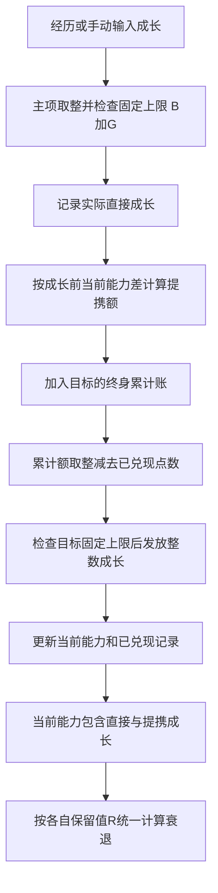

# 人物能力成长与终身提携数值设计

适用于晋书及南北朝题材的人生模拟。人物具有统帅、武力、智力、政治、魅力五项能力，能力影响对应事件结果；发展潜质决定成长空间，保留潜质决定年老后的能力保留程度。

**能力值为 0–100 的整数。提携按整个人生累计，达到取整阈值后发放；累计账保留小数。**

记录日期：2026 年 10 月 17 日。具体事件权重、年龄曲线和当前草案参数可继续调整。

## 五项能力

| 能力 | 主要作用 |
| --- | --- |
| 统帅 | 统领军队时的掌控力、训练效果与战术能力。 |
| 武力 | 个人勇武；影响冲锋陷阵、短兵相接、护卫、突发危险及武斗事件。 |
| 智力 | 计谋、出谋划策、劝说与说服。 |
| 政治 | 文书工作、地方治理、中央治理与战略能力。 |
| 魅力 | 人际交往、吸引人才、获得上司赏识、被拥立的可能性、征兵及组织个人武装，以及对他方决策的影响。 |

## 能力与潜质

| 参数 | 含义 | 约束 |
| --- | --- | --- |
| 初始基础 B | 人物初始化时的能力，普通成长时固定 | 0–100 整数 |
| 发展潜质 G | 在初始基础上最多可增长的空间 | 0–(100−B) 整数 |
| 成长上限 H | 初始基础与成长空间之和 | H=B+G，最大 100 |
| 保留潜质 R | 衰老充分发生时的绝对保留能力阈值 | B ≤ R ≤ B+G，整数 |
| 当前能力 C | 衰退前能力，包含直接成长与已兑现提携 | B ≤ C ≤ H，整数；新人物 C=B |
| 衰退进度 d | 衰老影响的累计进度 | 0–100%，与实际年龄的映射另定 |

每项能力分别拥有 B、G、R。B 与 G 在普通成长中固定，H=B+G 不随当前能力 C 增加而抬高。相同经历下，剩余成长空间 H−C 越大，成长越快；接近 H 时成长减慢，达到 H 后停止增长。R 使用能力点数，不使用百分比。

## 整数规则

对非负数 x，先保留整数部分；小数部分达到 0.4 时进 1，否则舍去。以下记为 Q(x)。

```text
Q(x) = floor(x) + (小数部分 ≥ 0.4 时取 1，否则取 0)
```

例如：Q(0.39)=0，Q(0.4)=1，Q(1.25)=1，Q(1.4)=2。

实际能力、直接成长和已兑现提携均为整数；公式中间值、提携系数及终身累计提携额可以保留小数。

## 直接成长

当前表单提供两种输入方式：直接填写本次主项提升，或填写经历基础成长量 E。按经历计算时，当前公式为：

```text
成长上限 H = B + G
本次原始直接成长 = E × (H − C) / 100
本次实际直接成长 Δ = min(H − C, Q(原始直接成长))
```

直接填写提升值时，仍先取整，再检查上限。后续提携按实际获得的 Δ 计算。当前表单对直接成长逐次取整；终身小数累计用于提携额。

## 终身累计提携

### 本次增加的提携额

主项 i 成长时，对存在提携关系、且成长前低于主项的目标 j 计算：

```text
本次提携额 q(i→j)
= max(0, 成长前 C_i − 成长前 C_j) × k_ij × (本次实际直接成长 Δ_i / 10)
```

统帅提携武力、智力时 k=0.15；所有流向魅力的提携默认 k=0.05；其余已配置关系默认 k=0.20。魅力接受其余四项的提携，所以单条提携系数更低。

能力差距统一使用本次成长前的数值。目标不低于主项时，本次新增提携额为 0；目标剩余潜质只限制发放上限，不再额外乘一次成长衰减。

### 累计与兑现

每项能力保存三项终身记录：累计直接成长 D、累计提携额 T、已兑现提携 P。D 只记录直接成长；T 汇总所有合法来源的未取整提携额；P 已包含在当前能力 C 中，不再重复相加。

```text
C_i ← C_i + Δ_i
D_i ← D_i + Δ_i
T_j ← T_j + 本次所有来源给予 j 的提携额
累计应得整数 = Q(T_j)
本次应发 = max(0, Q(T_j) − P_j)
本次实发 = min(本次应发, H_j − 当前 C_j)
P_j ← P_j + 本次实发
C_j ← C_j + 本次实发
```

累计阈值依次是 0.4、1.4、2.4……。例如累计额 0.4 已发 1 点，增加到 0.5 时仍累计应得 1 点，本次不再发放。

每次直接成长产生的提携额按当时的能力差和系数入账，之后只累加，不用最新能力差重算整个人生。不同来源对同一目标的提携先汇总，再统一取整。达到上限而无法兑现的应得点数保留在累计账中。

提携得到的成长不再产生新提携，避免递归增长。



### 提携关系与系数

| 成长主项 | 提携目标与系数 |
| --- | --- |
| 统帅 | 武力 15%、智力 15%、魅力 5% |
| 武力 | 统帅 20%、魅力 5% |
| 智力 | 统帅 20%、政治 20%、魅力 5% |
| 政治 | 智力 20%、魅力 5% |
| 魅力 | 当前无向外提携 |

每次成长同时检查所有关联目标，只有成长前较低的目标产生新增提携额。

## 数值示例

### 智力提升十点

成长前智力 60、政治 40、魅力 35；智力本次实际提升 10，变为 70。假定累计账初始为 0，且各项都有足够成长空间。

| 目标 | 本次原始提携额 | 累计应得整数 | 成长后能力 |
| --- | --- | --- | --- |
| 政治 | (60−40) × 0.20 × 10/10 = 4 | 4 | 44 |
| 魅力 | (60−35) × 0.05 × 10/10 = 1.25 | 1 | 36 |

魅力累计账保存 T=1.25、P=1；后续继续向 T 增加提携额。

### 统帅提携武力与智力

成长前统帅 80、武力 60、智力 50；统帅实际提升 10，变为 90。假定累计账初始为 0，且目标上限足够：

| 目标 | 本次原始提携额 | 本次兑现 | 成长后能力 |
| --- | --- | --- | --- |
| 武力 | (80−60) × 0.15 × 10/10 = 3 | 3 | 63 |
| 智力 | (80−50) × 0.15 × 10/10 = 4.5 | 5 | 55 |

统帅对魅力仍按 5% 计算；当统帅实际只提升 1 时，公式最后一项相应使用 1/10。

### 多次小成长

仍从智力 60、政治 40、魅力 35 开始，智力连续四次各实际提升 1 点。魅力在第四次结算前尚未增加，因此四次提携额分别为 0.125、0.13、0.135、0.14。

| 次数 | 成长前智力 | 魅力累计提携额 T | 魅力累计已兑现 P | 魅力能力 |
| --- | --- | --- | --- | --- |
| 1 | 60 | 0.125 | 0 | 35 |
| 2 | 61 | 0.255 | 0 | 35 |
| 3 | 62 | 0.390 | 0 | 35 |
| 4 | 63 | 0.530 | 1 | 36 |

单次未达到 0.4 的提携额不会丢失。四次结束后智力为 64、政治为 42、魅力为 36。

## 能力联动约束

创建新人物时，高统帅需要武力或智力中至少一项提供支撑，初始容差为 40：

```text
B_统帅 ≤ min(100, max(B_武力, B_智力) + 40)
```

统帅容差只检查初始基础 B；不限制各项成长上限 B+G，也不钳制成长后或衰老后的统帅能力。

**智力与政治只在新人物初始化时避免差距过大。成长和衰老阶段不强制智政差不超过 25。** 表单保留初始差上限 25 作为可调草案；已有角色的成长默认关闭初始检查。

## 衰老与能力保留

保留潜质 R 是绝对能力保留值，取值范围为 B 到 B+G。直接成长与提携成长都已计入当前能力 C，统一按该项 R 衰退。当前线性试算公式如下；d 按 0–100 的百分数填写：

```text
衰老后有效能力 V = Q(C − (d/100) × max(0, C − R))
```

d=0 时 V=C；d=100 时 V=min(C,R)。当 C≤R 时没有可衰退部分，能力保持 C，不会被抬高到 R。例如 B=60、G=30、H=90、R=75：C=90 时，d=50% 得 V=Q(82.5)=83，d=100% 得 V=75；C=70 时，两种衰退进度均保持 70。取整作用于最终能力，不先对损失量取整。

提携所得与直接成长统一衰退一次，不产生关联能力之间的衰退传播。衰退进度 d 每次从未衰退的 C 重算；不把 V 写回 C，不扣减终身累计账，也不再施加统帅容差。因此重复试算不会重复扣减能力。

## 表单操作与后续参数

“计算结果”只预览本次成长，重复点击不重复入账；“承接本次结果”才更新当前能力 C 和终身累计账。B、G、R 及固定上限 H 保持原值；承接不使用衰老后的有效能力 V。

当前参数为统帅向武力和智力提携 15%、普通提携 20%、魅力提携 5%、统帅初始容差 40，以及新人物初始智政差草案 25。尚待细化的内容是事件成功率与能力的映射、经历成长量 E 的分配、年龄与衰退进度的关系，以及其余提携关系草案的最终边界。

相关设计：[三道相性与诡道数值设计](./01-三道相性与诡道.md)。

---

来源：[人物能力成长与终身提携数值设计](https://chatgpt.com/space/page_cddaf7aef75c8191842a499341da49a1) · 本地保存日期：2026-10-17。

