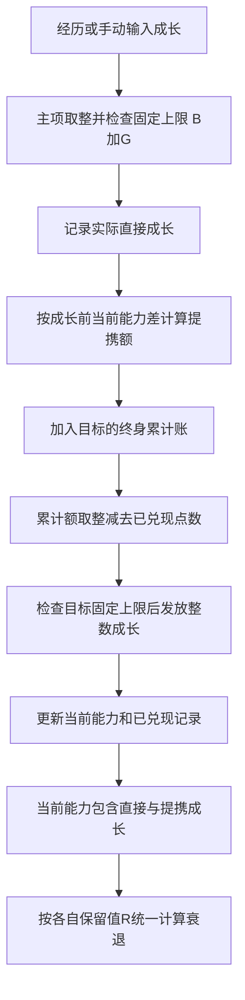

# 人物能力成长与终身提携数值设计

禀赋有厚薄，长进有分寸。本篇用于晋书及南北朝题材的人生模拟：统帅、武力、智力、政治、魅力五项能力，各管相应事件；发展潜质定还能长进多少，保留潜质定年老后能留下多少能力。

**能力值用 0–100 的整数。提携按一生累计，满取整阈值才发点数，小数仍留账上。**

立此章程于2026 年 10 月 17 日。事件权重、年龄曲线与草案参数，仍可续议。

## 五项能力

| 能力 | 主要作用 |
| --- | --- |
| 统帅 | 统领军队时的掌控力、训练效果与战术能力。 |
| 武力 | 个人勇武；影响冲锋陷阵、短兵相接、护卫、突发危险及武斗事件。 |
| 智力 | 计谋、出谋划策、劝说与说服。 |
| 政治 | 文书工作、地方治理、中央治理与战略能力。 |
| 魅力 | 人际交往、吸引人才、获得上司赏识、被拥立的可能性、征兵及组织个人武装，以及对他方决策的影响。 |

## 禀赋与长进

| 参数 | 含义 | 约束 |
| --- | --- | --- |
| 初始基础 B | 人物初始化时的能力，普通成长时固定 | 0–100 整数 |
| 发展潜质 G | 在初始基础上最多可增长的空间 | 0–(100−B) 整数 |
| 成长上限 H | 初始基础与成长空间之和 | H=B+G，最大 100 |
| 保留潜质 R | 衰老充分发生时的绝对保留能力阈值 | B ≤ R ≤ B+G，整数 |
| 当前能力 C | 衰退前能力，包含直接成长与已兑现提携 | B ≤ C ≤ H，整数；新人物 C=B |
| 衰退进度 d | 衰老影响的累计进度 | 0–100%，与实际年龄的映射另定 |

五项能力各有自己的 B、G、R。普通成长时，B 与 G 固定，H=B+G 也不会因当前能力 C 提高而跟着上涨。同样的经历，剩余空间 H−C 越大，长进越快；将近 H 时便慢下来，到 H 则止。R 记的是能力点数，不能当作百分比。

## 整数规则

非负数 x 先取整数部分；余下的小数满 0.4 就进 1，不满便舍去。此法记作 Q(x)。

```text
Q(x) = floor(x) + (小数部分 ≥ 0.4 时取 1，否则取 0)
```

例如：Q(0.39)=0，Q(0.4)=1，Q(1.25)=1，Q(1.4)=2。

落到人物身上的能力、直接成长和已兑现提携，都记整数；公式中间值、提携系数和一生累计的提携额，可以留小数。该留账的，不因一次未满就抹去。

## 直接成长

表单有两种填法：直接填本次主项提升，或填经历基础成长量 E。依经历结算，暂用此式：

```text
成长上限 H = B + G
本次原始直接成长 = E × (H − C) / 100
本次实际直接成长 Δ = min(H − C, Q(原始直接成长))
```

直接填提升值，也须先取整、再查上限。提携只按实际拿到的 Δ 计算。直接成长逐次取整；提携的小数，才记入终身累计账。

## 终身累计提携

### 本次增加的提携额

主项 i 有了长进，再看哪些能力能受提携：目标 j 须有既定提携关系，且成长前低于主项，才依下式计算：

```text
本次提携额 q(i→j)
= max(0, 成长前 C_i − 成长前 C_j) × k_ij × (本次实际直接成长 Δ_i / 10)
```

统帅带动武力、智力，k=0.15；流向魅力的提携，默认 k=0.05；其余已配置关系，默认 k=0.20。魅力能受其余四项提携，故每一路的系数较低。

能力差一律看本次成长前。目标已不低于主项，就不再受这次提携，新增额记 0。目标剩余潜质只管最多能发多少，不能再乘一遍成长衰减。

### 累计与兑现

一生的长进，分三项记：累计直接成长 D、累计提携额 T、已兑现提携 P。D 只收直接成长；T 收各合法来源尚未取整的提携额；P 已经算在当前能力 C 里，不能再添一遍。

```text
C_i ← C_i + Δ_i
D_i ← D_i + Δ_i
T_j ← T_j + 本次所有来源给予 j 的提携额
累计应得整数 = Q(T_j)
本次应发 = max(0, Q(T_j) − P_j)
本次实发 = min(本次应发, H_j − 当前 C_j)
P_j ← P_j + 本次实发
C_j ← C_j + 本次实发
```

累计阈值依次是 0.4、1.4、2.4……。例如累计额 0.4 已发 1 点，增加到 0.5 时仍累计应得 1 点，本次不再发放。

每次提携按当时的能力差、当时的系数入账，之后只往上累加，不拿今日的差距重算前半生。不同来源给同一目标的提携，先合账，再取整。上限已满、暂发不了的应得点数，仍在账上。

提携所得到此为止，不再引出新一轮提携，免得层层递增。



### 提携关系与系数

| 成长主项 | 提携目标与系数 |
| --- | --- |
| 统帅 | 武力 15%、智力 15%、魅力 5% |
| 武力 | 统帅 20%、魅力 5% |
| 智力 | 统帅 20%、政治 20%、魅力 5% |
| 政治 | 智力 20%、魅力 5% |
| 魅力 | 当前无向外提携 |

每有一次成长，相关目标一并查过；只有成长前较低者，才新增提携额。

## 数值示例

### 智力提升十点

成长前智力 60、政治 40、魅力 35；智力本次实际提升 10，变为 70。假定累计账初始为 0，且各项都有足够成长空间。

| 目标 | 本次原始提携额 | 累计应得整数 | 成长后能力 |
| --- | --- | --- | --- |
| 政治 | (60−40) × 0.20 × 10/10 = 4 | 4 | 44 |
| 魅力 | (60−35) × 0.05 × 10/10 = 1.25 | 1 | 36 |

魅力累计账保存 T=1.25、P=1；后续继续向 T 增加提携额。

### 统帅提携武力与智力

成长前统帅 80、武力 60、智力 50；统帅实际提升 10，变为 90。假定累计账初始为 0，且目标上限足够：

| 目标 | 本次原始提携额 | 本次兑现 | 成长后能力 |
| --- | --- | --- | --- |
| 武力 | (80−60) × 0.15 × 10/10 = 3 | 3 | 63 |
| 智力 | (80−50) × 0.15 × 10/10 = 4.5 | 5 | 55 |

统帅对魅力仍按 5% 计算；当统帅实际只提升 1 时，公式最后一项相应使用 1/10。

### 多次小成长

仍从智力 60、政治 40、魅力 35 开始，智力连续四次各实际提升 1 点。魅力在第四次结算前尚未增加，因此四次提携额分别为 0.125、0.13、0.135、0.14。

| 次数 | 成长前智力 | 魅力累计提携额 T | 魅力累计已兑现 P | 魅力能力 |
| --- | --- | --- | --- | --- |
| 1 | 60 | 0.125 | 0 | 35 |
| 2 | 61 | 0.255 | 0 | 35 |
| 3 | 62 | 0.390 | 0 | 35 |
| 4 | 63 | 0.530 | 1 | 36 |

一次不满 0.4，也不作废。四次算完，智力为 64、政治为 42、魅力为 36；零星所得，账上也有分明。

## 能力联动约束

创建新人物时，高统帅需要武力或智力中至少一项提供支撑，初始容差为 40：

```text
B_统帅 ≤ min(100, max(B_武力, B_智力) + 40)
```

统帅容差只在初始基础 B 上查验；各项成长上限 B+G 不受它限制，成长后、衰老后的统帅也不再用它钳制。

**智力与政治只在新人物初始化时避免差距过大。成长和衰老阶段不强制智政差不超过 25。** 表单保留初始差上限 25 作为可调草案；已有角色的成长默认关闭初始检查。

## 衰老与能力保留

人会老，所得能力怎样留下，仍须按章结算。保留潜质 R 是绝对能力值，范围从 B 到 B+G。直接与提携所得都已在当前能力 C 中，衰退时一并依该项 R 计算。线性试算暂用下式，d 按 0–100 的百分数填写：

```text
衰老后有效能力 V = Q(C − (d/100) × max(0, C − R))
```

d=0 时 V=C；d=100 时 V=min(C,R)。当 C≤R 时没有可衰退部分，能力保持 C，不会被抬高到 R。例如 B=60、G=30、H=90、R=75：C=90 时，d=50% 得 V=Q(82.5)=83，d=100% 得 V=75；C=70 时，两种衰退进度均保持 70。取整作用于最终能力，不先对损失量取整。

直接成长与提携所得一并衰退一次，不牵连其他能力再衰退。每次按衰退进度 d 从原本未衰退的 C 重算；V 不写回 C，终身累计账不扣，统帅容差也不再加上去。试算多少次，都不能重复扣点。

## 表单操作与后续参数

点“计算结果”，只是试看本次长进，多点几次也不入账；点“承接本次结果”，才更新当前能力 C 与终身累计账。B、G、R 和固定上限 H 原样保留，承接时不用衰老后的有效能力 V。

暂定参数为统帅向武力和智力提携 15%、普通提携 20%、魅力提携 5%、统帅初始容差 40，以及新人物初始智政差草案 25。其余尚待定式：能力如何影响事件成功率，经历成长量 E 如何分配，年龄怎样对应衰退进度，以及其余提携关系草案的最终边界。

相关设计：[三道相性与诡道数值设计](./01-三道相性与诡道.md)。

---

来源：[人物能力成长与终身提携数值设计](https://chatgpt.com/space/page_cddaf7aef75c8191842a499341da49a1) · 本地保存日期：2026-10-17。

