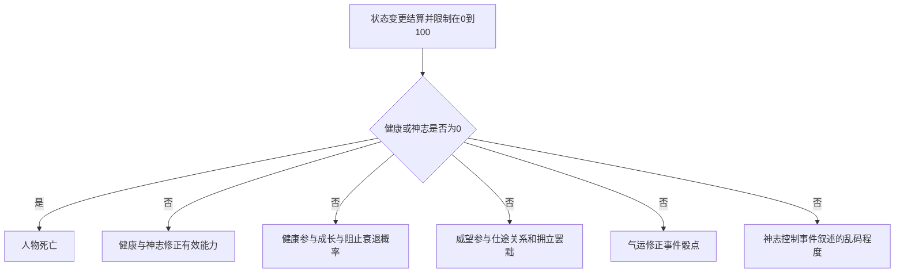

# 人物状态与出生数值设计

人在世间，身心、声名与运数都要记。状态仍分健康、神志、威望、气运四项，取值均为 0–100：健康与神志管生存和能力表现，威望参与社会事件，气运修正掷骰结果。

**健康或神志任一降到 0，便是身死事终。高健康增加成长及阻止能力下降的概率；普通出生威望至多 40，祥瑞带来的增益另算。**

立此章程于2026 年 10 月 17 日。分档端点暂依下表；扣减比例、概率增幅和出生权重，留待定数。

## 状态总表

| 状态 | 核心作用 | 普通初始范围 |
| --- | --- | --- |
| 健康 | 身体状况、当前能力表现、成长与阻止衰退的概率；归零死亡 | 20–80 |
| 神志 | 精神状态、智力与政治表现、事件文本可读程度；归零死亡 | 60–100 |
| 威望 | 个人威名、仕途、人际关系及拥立、罢黜等事件 | 白身出身为 0；其他出身依条件分配，最多 40 |
| 气运 | 事件结果掷骰的有利或不利修正 | 随机 20–80 |

## 健康

### 健康分档

| 健康值 | 状态 | 效果 |
| --- | --- | --- |
| 0 | 死亡 | 结束人物人生结算 |
| 0＜健康＜20 | 垂危 | 五项能力大幅扣减 |
| 20≤健康＜40 | 较差 | 五项能力轻微扣减 |
| 40≤健康＜60 | 正常 | 无健康增益或减益 |
| 60≤健康＜80 | 良好 | 轻微增加能力成长的可能性，以及阻止能力下降的可能性 |
| 80≤健康≤100 | 极佳 | 大幅增加上述两种可能性 |

分档须看准端点：20 属轻微扣减，40 属正常，60 属轻度概率增益，80 属大幅概率增益。两档各扣多少、概率各增多少，尚未定数。

身体康健，增益落在“能否成长”和“能否阻止能力下降”的概率上，不直接添能力点，也不自动放大一次的成长量。成长既已发生，仍依能力系统的成长空间、提携和上限结算。

### 武力对健康的增益

武力≤50，不另增健康收益；武力＞50，增益才随武力递增。增益函数记作 f：

```text
武力健康增益 = 0                         当武力 ≤ 50
武力健康增益 = f(武力 − 50)，且 f 递增     当武力 > 50
```

这份增益究竟落在健康点数、恢复速度还是抗损伤概率上，系数又该多少，暂未定式。衔接草案先读状态扣减前的武力，免得健康扣了武力，武力又立刻反扣健康；界面刷新也不能反复添健康。

## 神志

| 神志值 | 能力影响 | 前端表现 |
| --- | --- | --- |
| 0 | 死亡 | 转入死亡结果 |
| 0＜神志＜20 | 智力、政治大幅扣减 | 对应事件叙述逐渐变成乱码，神志越低越严重 |
| 20≤神志＜40 | 智力、政治轻微扣减 | 当前未设置额外乱码 |
| 40≤神志≤100 | 当前未设置神志能力修正 | 正常显示 |

端点照此记：20 属轻微扣减，40 恢复正常。神志再高，眼下也没有另设能力增益。

神志昏乱时，暂以事件叙述乱码来表现。只乱显示，不乱事件数据、骰点和真实因果；状态数值、按钮、死亡提示仍须读得明白。同一事件的乱码样式保持稳定，神志恢复后可重归正常。具体乱到什么程度，尚未定式。

## 威望

人有其名，名未必人人相悦。威望记已有的威名和社会影响，参与仕途、人际关系、拥立与罢黜等事件；魅力另记，管交往与吸引能力。各类事件怎样用威望，尚未配置，不能一概换成旁人的好感。

### 普通出生威望

白身出身，普通出生威望记 0；其他出身依下列条件分配，总值至多 40：

| 出生因素 | 待配置内容 |
| --- | --- |
| 家族出身 | 家族规模、势力或地位档次 |
| 出生身份 | 该人物出生时的身份等级 |
| 男女 | 对应时代与家族条件下的出生权重 |
| 嫡庶 | 嫡出或庶出的权重 |
| 是否长子 | 长子身份的权重 |

各项权重怎样合算，暂且未定。40 只管普通出生，可不是一生威望的上限。

## 气运

气运有偏，骰点有增减。50 为中性；从 50 增至 100，修正线性增至 +10；从 50 降至 0，修正线性减至 −10：

```text
气运骰点修正 = (气运 − 50) / 5
```

| 气运 | 骰点修正 |
| --- | --- |
| 0 | −10 |
| 20 | −6 |
| 50 | 0 |
| 80 | +6 |
| 100 | +10 |

采用高点有利的事件判定时：

```text
判定点数 = 原始骰点 + 气运骰点修正 + 其他事件修正
```

若事件以低点成功，修正方向便反过来，总要让高气运有利。骰子范围、阈值和越界处理另定；+10 骰点不能直接说成成功率增加 10%。线性公式先留小数，最终怎样取整，仍待定式。

## 出生初始化与祥瑞

初生之时，健康取 20–80、神志取 60–100，气运随机取 20–80；威望依出身分到 0–40。眼下只定范围，尚未定均匀分布、其他分布，也未定各项之间有无关联。

出生若有祥瑞，作为独立事件另算：额外增加威望、气运，具体事件也可增加健康、神志等状态：

```text
最终出生状态 = clamp(普通出生状态 + 祥瑞增益, 0, 100)
```

祥瑞所得可让出生威望越过普通上限 40，也可让健康或气运越过普通初始上限 80；但状态总上限仍是 100。武力健康增益何时加入初始化，待其作用方式定下后再排顺序。

## 与能力系统的衔接草案

状态不好，扣的是事件所用的有效能力；初始 B、成长空间 G、保留潜质 R、当前成长能力 C 和终身提携累计账，都不改。状态恢复，对应的临时扣减也就解除。

健康与神志都可能影响智力、政治，两项同时扣减时怎样合算、各扣多少、最多扣到哪里，仍未定下。高健康阻止下降的概率如何接入衰退公式，也另议；眼下不直接改写 R 或衰退进度。



健康或神志归零，先结人物一生，后续成长、提携和普通恢复都不再执行。事件引起的状态变更依逻辑结算，不能因界面重绘而再算一遍。

## 待定参数

| 参数组 | 尚需确定 |
| --- | --- |
| 能力扣减 | 健康与神志轻微、大幅扣减的比例或点数，以及共同作用的合成方式 |
| 概率增益 | 高健康两档的成长概率增益、阻止下降概率增益与基础概率 |
| 武力增益 | 健康点数、恢复速度或抗损伤概率，以及系数与结算时点 |
| 文本乱码 | 神志与乱码比例的映射、适用事件范围 |
| 出生分配 | 家族与身份各项权重、状态生成分布、祥瑞事件的具体增量 |
| 数值精度 | 状态值与骰点的取整规则；能力系统的 0.4 规则暂不自动套用到骰点 |

相关设计：[人物能力成长与终身提携数值设计](./02-人物能力成长与终身提携.md)。

---

来源：[人物状态与出生数值设计](https://chatgpt.com/space/page_cace970692388191954525fae770ad6c) · 本地保存日期：2026-10-17。

