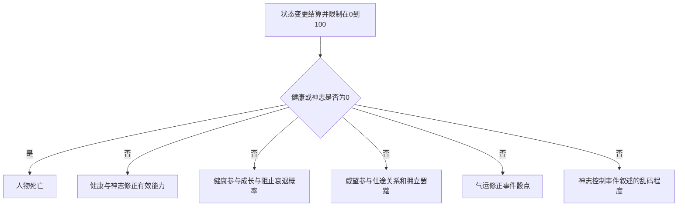

# 人物状态与出生数值设计

人物状态分为健康、神志、威望、气运，取值均为 0–100。健康与神志关联生存和能力表现，威望参与社会事件，气运修正事件掷骰结果。

**健康或神志任一降到 0，人物死亡。高健康增加成长及阻止能力下降的概率；普通出生威望最高 40，祥瑞增益另外结算。**

记录日期：2026 年 10 月 17 日。分档端点按下表暂定，具体扣减比例、概率增幅和出生权重保留为参数。

## 状态总表

| 状态 | 核心作用 | 普通初始范围 |
| --- | --- | --- |
| 健康 | 身体状况、当前能力表现、成长与阻止衰退的概率；归零死亡 | 20–80 |
| 神志 | 精神状态、智力与政治表现、事件文本可读程度；归零死亡 | 60–100 |
| 威望 | 个人威名、仕途、人际关系及拥立、罢黜等事件 | 白身出身为 0；其他出身依条件分配，最多 40 |
| 气运 | 事件结果掷骰的有利或不利修正 | 随机 20–80 |

## 健康

### 健康分档

| 健康值 | 状态 | 效果 |
| --- | --- | --- |
| 0 | 死亡 | 结束人物人生结算 |
| 0＜健康＜20 | 垂危 | 五项能力大幅扣减 |
| 20≤健康＜40 | 较差 | 五项能力轻微扣减 |
| 40≤健康＜60 | 正常 | 无健康增益或减益 |
| 60≤健康＜80 | 良好 | 轻微增加能力成长的可能性，以及阻止能力下降的可能性 |
| 80≤健康≤100 | 极佳 | 大幅增加上述两种可能性 |

端点约定：20 属轻微扣减，40 属正常，60 属轻度概率增益，80 属大幅概率增益。两档扣减的具体数值和两档概率增幅待定。

高健康的增益作用于成长是否发生、能力下降是否被阻止。它不直接增加当前能力点数，也不自动放大单次成长量。成长一旦发生，仍使用能力系统的成长空间、提携和上限规则。

### 武力对健康的增益

武力≤50 时没有对应健康增益；武力＞50 时，增益随武力递增。记增益函数为 f：

```text
武力健康增益 = 0                         当武力 ≤ 50
武力健康增益 = f(武力 − 50)，且 f 递增     当武力 > 50
```

增益究竟增加健康点数、恢复速度还是抗损伤概率，以及具体系数，尚待确定。衔接草案：读取状态扣减前的武力，避免健康扣武力后又即时反向扣健康的循环；不得每次刷新界面就重复加健康。

## 神志

| 神志值 | 能力影响 | 前端表现 |
| --- | --- | --- |
| 0 | 死亡 | 转入死亡结果 |
| 0＜神志＜20 | 智力、政治大幅扣减 | 对应事件叙述逐渐变成乱码，神志越低越严重 |
| 20≤神志＜40 | 智力、政治轻微扣减 | 当前未设置额外乱码 |
| 40≤神志≤100 | 当前未设置神志能力修正 | 正常显示 |

端点约定：20 属轻微扣减，40 恢复正常。高神志目前没有额外能力增益。

乱码表现草案：只改变事件叙述的显示，不改事件数据、掷骰结果和真实因果；状态数值、操作按钮和死亡提示保持可读。同一事件的乱码显示保持稳定，神志恢复后可恢复正常显示。乱码比例与神志的具体映射待定。

## 威望

威望表示个人威名，参与仕途发展、他人对人物的关系，以及拥立、罢黜等事件。威望与魅力分别记录：魅力影响交往与吸引能力，威望表示人物已具有的社会影响。具体事件如何使用威望尚待配置，不统一折算成对所有人的好感。

### 普通出生威望

白身出身的普通出生威望为 0。其他出身根据下列条件分配，普通出生威望总值最多 40：

| 出生因素 | 待配置内容 |
| --- | --- |
| 家族出身 | 家族规模、势力或地位档次 |
| 出生身份 | 该人物出生时的身份等级 |
| 男女 | 对应时代与家族条件下的出生权重 |
| 嫡庶 | 嫡出或庶出的权重 |
| 是否长子 | 长子身份的权重 |

各项权重和组合方式待定；不得把 40 误作人物终身威望上限。

## 气运

气运 50 为中性。气运从 50 增至 100，骰点修正线性增加到 +10；从 50 降至 0，线性减少到 −10：

```text
气运骰点修正 = (气运 − 50) / 5
```

| 气运 | 骰点修正 |
| --- | --- |
| 0 | −10 |
| 20 | −6 |
| 50 | 0 |
| 80 | +6 |
| 100 | +10 |

采用高点有利的事件判定时：

```text
判定点数 = 原始骰点 + 气运骰点修正 + 其他事件修正
```

若事件采用低点成功，修正方向应相反，使高气运始终有利。骰子的范围、阈值和越界处理另定；+10 骰点不直接等同于成功率增加 10%。线性公式先保留小数，最终骰点取整规则另定。

## 出生初始化与祥瑞

普通初始范围为健康 20–80、神志 60–100、气运随机 20–80；威望按出身分配至 0–40。当前只确定范围，尚未指定均匀分布、其他分布或状态间的相关性。

出生祥瑞作为独立事件，额外增加威望和气运，也可由具体事件增加健康、神志等状态：

```text
最终出生状态 = clamp(普通出生状态 + 祥瑞增益, 0, 100)
```

祥瑞增益可以使出生威望超过普通出生上限 40，也可以使健康或气运超过普通初始上限 80；最终仍受状态总上限 100 限制。武力健康增益在初始化中的加入顺序，待其作用方式确定后再配置。

## 与能力系统的衔接草案

状态扣减作用于事件使用的有效能力，不改动初始 B、成长空间 G、保留潜质 R、当前成长能力 C 和终身提携累计账。状态恢复后，对应临时扣减解除。

健康与神志可能同时影响智力、政治；两种扣减的合成方式、比例和总扣减上限待定。高健康的阻止下降概率如何接入既有衰退公式，也需另定；当前不直接改写 R 或衰退进度。



健康或神志归零后优先进入死亡流程，不再执行人物的后续成长、提携或普通恢复。事件造成的状态变更按逻辑结算，不按界面重绘重复执行。

## 待定参数

| 参数组 | 尚需确定 |
| --- | --- |
| 能力扣减 | 健康与神志轻微、大幅扣减的比例或点数，以及共同作用的合成方式 |
| 概率增益 | 高健康两档的成长概率增益、阻止下降概率增益与基础概率 |
| 武力增益 | 健康点数、恢复速度或抗损伤概率，以及系数与结算时点 |
| 文本乱码 | 神志与乱码比例的映射、适用事件范围 |
| 出生分配 | 家族与身份各项权重、状态生成分布、祥瑞事件的具体增量 |
| 数值精度 | 状态值与骰点的取整规则；能力系统的 0.4 规则暂不自动套用到骰点 |

相关设计：[人物能力成长与终身提携数值设计](./02-人物能力成长与终身提携.md)。

---

来源：[人物状态与出生数值设计](https://chatgpt.com/space/page_cace970692388191954525fae770ad6c) · 本地保存日期：2026-10-17。

