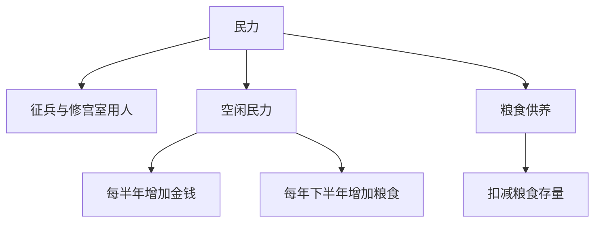

# 地块参数与钱粮收支

一地之用，先记民力、金钱、粮食。募兵、修宫室要用民力，供养民力也要耗粮；空闲民力则决定钱粮增收。

记录日期：2026-10-18。三项参数、增收周期与一位小数的精度已定；产出、消耗及民力分配的细则待定。

## 三项参数

每个地块记录以下三项参数，均允许一位小数。

| 参数 | 含义 | 已定用途与变化 |
| --- | --- | --- |
| 民力 | 地块可安排使用的民力 | 可用于征兵，也可作为修宫室的劳力；民力本身需要消耗粮食 |
| 金钱 | 地块现有金钱存量 | 每半年增加一次，收入根据空闲民力计算 |
| 粮食 | 地块现有粮食存量 | 每年下半年增加一次，收入根据空闲民力计算；民力耗粮另行扣记 |

地块的初始值、计量单位和数值上下限尚未规定。

## 空闲民力

空闲民力是尚未用于征兵、修宫室等已定用途的可用部分，作为钱粮收入的计算依据。用于征兵或营造的同一份民力，不能同时算作空闲民力。

征兵究竟使民力转出，还是形成持续占用；宫室劳役何时占用、何时释放，均待后续确定。钱粮结算采用哪个时点的空闲民力，或采用半年的平均值，也暂不定式。

## 钱粮增收周期

沿用[剧本一](./05-剧本一-苻坚上位，淝水之战.md)每回合半年的时间尺度：

| 时段 | 金钱收入 | 粮食收入 |
| --- | --- | --- |
| 每年上半年 | 按空闲民力增加一次 | 本半年无定期产粮增收 |
| 每年下半年 | 按空闲民力增加一次 | 按空闲民力增加一次 |

金钱一年增收两次，粮食一年增收一次。“刷新”是在现有存量上增加当期收入，原有存量继续保留。

```text
金钱增收时：新金钱存量 = 原金钱存量 + 本期金钱收入
粮食增收时：新粮食存量 = 原粮食存量 + 本期粮食收入

本期金钱收入 = 金钱产出函数(空闲民力)
本期粮食收入 = 粮食产出函数(空闲民力)
```

产出函数及系数尚未确定，目前只确定收入依据为空闲民力。增收在回合开始还是结束、355年下半年开局是否立即结算首次收入，另待配置。

## 民力耗粮

民力需要粮食供养，耗粮记为粮食支出。产粮与耗粮分开记账，上半年没有定期产粮增收，不等于免除供养。

计入口粮的民力范围、单位耗粮量和扣粮周期尚待确定。征出的士兵如何转入军队供给，也须与民力口粮分清，避免同一批人重复计耗；缺粮后的处理暂未规定。



## 数值精度

民力、金钱、粮食允许一位小数，例如 100.0、100.5。地块收入和耗粮的记账结果也按一位小数表示；计算中间值的精度，以及超过一位小数时的进舍办法，尚待确定。

此处规定的是地块数值精度。[资产章程](./04-资产数值设计.md)中的士兵数量仍使用非负整数，民力换算为士兵的人数比例与取整办法另定。

## 待定细则

| 项目 | 待定内容 |
| --- | --- |
| 地块初值 | 各地民力、金钱、粮食的初始值、计量单位与上下限 |
| 民力分配 | 征兵转出或占用、宫室劳役的占用与释放、民力恢复或增长规则 |
| 钱粮收入 | 产出函数、系数及空闲民力的取值时点 |
| 结算顺序 | 回合内增收、征用与耗粮的先后，开局首期的处理 |
| 粮食供养 | 口粮计算基数、单位消耗、扣粮周期与缺粮后果 |
| 数值进舍 | 超过一位小数时如何处理，民力转兵如何得到整数人数 |
| 资源支配 | 中央与地方如何支配地块资源；地块钱粮与人物金钱、兵粮如何调拨 |

地块名目与归属见[地图地块与中央地方](./06-地图地块与中央地方.md)。
