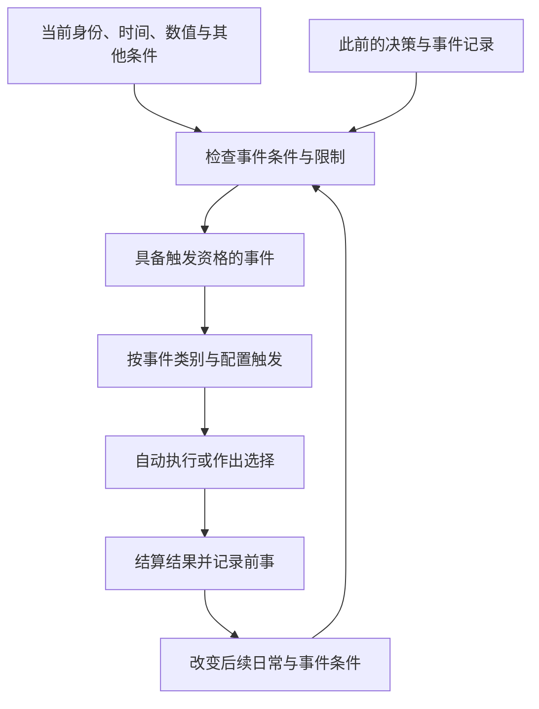

# 事件参数与触发规则

人有所为，事有所因。事件依身份、岁时、数值和既往抉择触发，结果再记入人物与地块，成为后来之事的条件。

记录日期：2026-10-18。标签分类、各类事件的作用及回合消耗已定；概率、条件组合的默认方式和同回合执行先后尚待细化。时间记法见[时间与回合](./09-时间与回合.md)。

## 触发条件标签

每个事件都有触发条件标签，按下列维度分类；各类均可继续扩充。一个事件可组合多个维度，例如日常事件同时受年龄、身份和此前决策约束。

| 标签分类 | 已提出的标签或条件 | 作用 |
| --- | --- | --- |
| 事件频率 | 日常事件、随机事件、决策事件、天意事件、事件后续等 | 区分事件如何发生、如何推进 |
| 身份条件 | 晋皇室、世家大族、流民领袖、文人、白身、鲜卑族、权臣、地方势力等 | 根据人物身份、族属或所处地位筛选 |
| 时间条件 | 襁褓、幼年、少年、特定年月，如370年上半年；结婚后三年等 | 按年龄阶段、绝对时间或某事之后的间隔触发 |
| 数值条件 | 武力＞50、相性在指定范围、兵粮低于指定值等 | 对已有数值作比较或范围判断 |
| 其他条件 | 谋臣、抑郁、鬼上身、祥瑞、磕多了等 | 记录身边的人手、特殊状态或遭遇 |
| 决策条件 | 此前作出某个选择，或该选择留下的持续效果 | 使之前的抉择影响后续事件，常与日常事件合用 |
| 限制条件 | 只发生一次、每隔指定时间发生一次等 | 限定发生次数或重复间隔 |

“事件频率”沿用当前分类名，日常、随机、天意等标签本身不代表具体概率。身份标签也不构成一组选一的身份；族属、家世和当前地位可以分别成为条件。

“谋臣”在这里指身边有谋臣。抑郁、鬼上身、祥瑞、磕多了等标签如何获得、持续多久、怎样解除，以及是否影响数值，均由后续设计确定。

## 各类事件

| 类别 | 触发与执行 | 主要用途 |
| --- | --- | --- |
| 日常事件 | 基本自动进行，依据此前决策及当前条件执行 | 通常带来能力、状态、地块等参数变化；不同年纪可以执行不同日常 |
| 随机事件 | 随机发生，仍可配置身份、时间等触发条件 | 遇刺、宴会出事、战前动员、祥瑞、鬼魂等 |
| 决策事件 | 到了指定间隔，或遇到必须应对的事由，要求主角作出决定 | 三年、五年、十年等阶段性抉择；战事、特定密谋或他人来找事 |
| 天意事件 | 由 AI 以“天意爷”的角色选择事件，使事态发展更有趣 | 介入事件选择与叙事节奏；具体选取办法待定 |
| 事件后续 | 根据前事及其选择，在之后满足条件时再次触发或进入后续事件 | 例如婚姻事件选了“先不结婚”，几年后可能再触发一次 |

三年、五年、十年是可配置的决策间隔示例，不是所有人物统一采用的周期。战事、密谋等事由也可引出决策，无须仅按固定年限出现。

事件后续要记清前事和所选分支。婚姻中的“先不结婚”可以留下后续条件，但隔几年、是否必定再问，目前都未定。后续可以再次引出决策；是否允许一个事件同时拥有多个“事件频率”标签，留待事件表结构定稿。

天意目前确定的职责是由 AI 选事件。是否只从既有事件库选取、是否允许生成新事件，以及能否例外触发尚不满足条件的事件，均待确定。

## 回合消耗

每半年只触发一个占用回合的事件，一个此类事件占用一整个回合。部分事件可以设为不占用回合，在该名额之外触发。

每个事件独立记录“回合消耗”，默认值为1，例外设为0：

| 回合消耗 | 规则 |
| --- | --- |
| 1 | 占用本回合唯一的事件名额，正常完成后推进一回合，即半年 |
| 0 | 不占用该名额，不推进时间；自身结果、决策和发生次数仍正常记录 |

是否自动执行与是否占用回合分别配置，日常事件不会仅因自动执行就免除回合消耗。事件后续也按自身的回合消耗处理；占回合的后续不能在同一个半年内再占第二个名额。

不占回合事件仍受触发条件、次数和间隔限制约束。具体哪些事件不占回合、一回合可出现多少个，以及在占回合事件前后怎样安排，尚待确定。

## 条件的写法

标签标明条件属于哪类，具体触发仍需写出判断内容。以下是编排建议，不设隐含的“全部满足”或“满足一个即可”默认值。

| 条件 | 编排时需要写清 |
| --- | --- |
| 多个标签 | 哪些须全部满足，哪些满足其一即可，哪些用于排除 |
| 数值比较 | 对象、参数、比较符号、阈值或区间，以及是否包含端点 |
| 相性范围 | 使用相性角、稳定度还是主辅分类；角度区间跨越0时应注明，120与0同位 |
| 能力门槛 | 使用当前成长能力，还是经过衰老、健康和神志修正后的有效能力 |
| 时间判断 | 指定时点、年龄阶段、经过多久，或可触发的时间窗口 |
| 决策与前事 | 哪个事件、哪个选择、从何时起生效，是否仍然有效 |
| 次数与间隔 | 对谁或哪件事计数，从何时起算；“每隔一段时间发生一次”指固定周期，还是两次发生至少相隔多久 |

条件满足只说明具备触发资格。随机如何抽中、多个合格事件如何安排，以及天意如何选择，仍须各自配置，不能由一个标签推导出必定发生。

## 事件记录字段草案

为了让事件能被配置、回看并连接后续，先按以下字段整理。回合消耗取0或1的规则已定，其余记录结构仍为草案，不新增具体剧情或数值效果。

| 字段 | 记录内容 |
| --- | --- |
| 事件标识与名称 | 用于区分事件、引用前事和查阅发生记录 |
| 标签与条件 | 上述七类标签及具体判断；不适用的维度可留空 |
| 执行方式 | 自动执行、提供选择，或由具体事件另行规定 |
| 回合消耗 | 0或1，默认1；0表示不占回合，1表示占用一回合 |
| 选择与结果 | 可选分支、判定方式及各分支产生的效果 |
| 参数变化 | 影响哪个人物或地块、哪些能力／状态／资源，具体如何变化 |
| 决策记录 | 这次选择留下什么后续条件或持续效果 |
| 后续关联 | 关联的事件、所需分支、延迟或时间窗口 |
| 次数与时间记录 | 已发生次数、发生时间及所选分支，供限制和后续判断使用 |

日常事件一般自动改变参数，具体事件仍须写清变化对象和数值。随机、天意及后续事件是否另含玩家选项，依事件配置。

图示表达因果关系，仍受每回合一个占回合事件的限制；不占回合事件的触发位置与执行先后尚未确定。

## 与已有参数衔接

- 能力成长、提携与衰退依[能力章程](./02-人物能力成长与终身提携.md)结算，事件不能另用一套取整或上限。
- 健康、神志、威望及气运依[状态章程](./03-人物状态与出生.md)作用。气运已有的是事件结果的骰点修正，尚未规定它同时改变事件被抽中的概率。
- 人物兵粮、金钱、士兵依[资产章程](./04-资产数值设计.md)记录；地块民力、金钱、粮食依[地块钱粮章程](./07-地块参数与钱粮收支.md)记录，须写清归属对象。
- 数值精度沿用各系统原有约定：能力为整数，士兵数量为非负整数，地块三项允许一位小数；不能把地块精度一并套给所有事件字段。

## 待定细则

| 项目 | 后续需定 |
| --- | --- |
| 条件组合 | 全部、任一、排除的配置形式，以及没有填写条件时的含义 |
| 随机与天意 | 抽取概率、权重、候选数量、AI选取范围及约束 |
| 事件调度 | 不占回合事件的数量与具体配置、事件优先级与冲突处理、能否立即处理不占回合的后续；没有合格占回合事件时如何处理 |
| 后续与限制 | 延迟、到期失效、重复上限，以及“只发生一次”是否约束同一事件的后续重触发 |
| 效果持续 | 决策效果与特殊标签的生效、结束及覆盖办法 |
