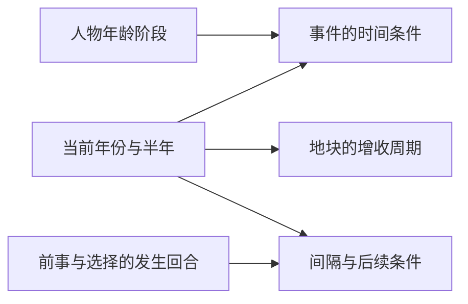

# 时间与回合

岁时向前，前事留痕。统一用半年回合记当前时间，再据年纪、历史时点和前事间隔判断事件。

记录日期：2026-10-18。沿用[剧本一](./05-剧本一-苻坚上位，淝水之战.md)已定的开局与步长；本篇统一时间记法，不增设剧情。

## 回合基准

| 参数 | 已定规则 |
| --- | --- |
| 剧本一开局 | 355年下半年 |
| 主角初始年龄 | 0岁 |
| 每回合时长 | 半年 |
| 占回合事件 | 每半年只触发一个，每个占用一整个回合 |
| 不占回合事件 | 作为例外额外触发，不占上述名额，也不推进时间 |
| 历法推进 | 当年上半年 → 当年下半年 → 次年上半年 |

为便于计算，下文用从0开始的回合序号 `t`；`t=0` 表示开局时点，经过一个完整回合后 `t=1`。序号记法不规定前端应显示“第0回合”还是“第1回合”。

| 回合序号 t | 当前时间 | 距开局经过 |
| --- | --- | --- |
| 0 | 355年下半年 | 0年 |
| 1 | 356年上半年 | 0.5年 |
| 2 | 356年下半年 | 1年 |
| 6 | 358年下半年 | 3年 |
| 29 | 370年上半年 | 14.5年 |

历法只需记年份和上／下半年。若要统一比较，可将上半年记为 `h=0`、下半年记为 `h=1`：

```text
半年度序号 = 2 × 年份 + h
两个时点相隔回合数 = 后一时点的半年度序号 − 前一时点的半年度序号
经过年数 = 相隔回合数 / 2
```

主角初始为0岁；具体生日、年龄显示方式与阶段划分尚未确定，暂不把上述“经过年数”强行当作人物年龄的显示格式。

## 事件与时间推进

事件的“回合消耗”记为0或1，默认1。正常完成事件后的时间推进为：

```text
新回合序号 = 原回合序号 + 事件的回合消耗
本次经过年数 = 事件的回合消耗 / 2
```

| 事件 | 回合序号 | 历法与经过时间 |
| --- | --- | --- |
| 占回合，消耗1 | t → t+1 | 推进到下一个半年，经过0.5年 |
| 不占回合，消耗0 | t → t | 保持当前半年，经过0年 |

不占回合事件正常结算自身效果，也记录选择与发生次数；但它不会因完成一次，就推进年龄、周期计时或后续倒计时。因此，婚后三年仍须经过6个回合，不能靠处理6个不占回合事件来抵算。

每回合只有一个占回合事件的名额。不占回合事件可以在该名额之外发生，其数量、触发位置和先后顺序暂不限定为某个固定方案。

## 时间条件

| 形式 | 示例 | 判断依据 |
| --- | --- | --- |
| 年龄阶段 | 襁褓、幼年、少年 | 人物处于对应阶段；各阶段年龄边界待定 |
| 绝对时间 | 370年上半年 | 当前年份及半年，与指定时点相符 |
| 前事间隔 | 结婚后三年 | 从结婚发生的回合起计算，三年相隔6回合 |
| 决策间隔 | 三年、五年或十年后需要再作决定 | 分别对应6、10、20回合；具体起算点由事件规定 |
| 后续延迟 | 选择“先不结婚”几年后再触发 | 从该次选择的回合起计算；延迟年数和是否必定触发待定 |
| 重复限制 | 只发生一次、每隔指定时间发生一次 | 结合事件发生次数、上次发生时间或指定周期判断 |

时间条件可与日常事件合用，使不同年纪有不同日常；也可用于触发历史事件。给历史事件配置日期，只确定时间条件，其他身份、数值和前事条件仍依该事件规定。

“结婚后三年”的起算点是结婚，“先不结婚后的后续”则从作出该选择起算，两者分别记录。

```text
若结婚发生在回合 m：三年后的时点 = m + 6
若某决策以五年为间隔：下一对应时点 = 本次起算回合 + 10
若某决策以十年为间隔：下一对应时点 = 本次起算回合 + 20
```

这些式子只换算时间，不将“可能触发”改为“必定触发”。到了指定时间但其他条件不满足时，是跳过、延期还是保留到某个期限，尚待配置。

## 回合所需记录

以下为配合事件判断的记录字段草案：

| 记录 | 用途 |
| --- | --- |
| 当前年份、半年与回合序号 | 统一推进历法，判断绝对时间与间隔 |
| 人物年龄信息 | 判断襁褓、幼年、少年等阶段 |
| 前事与决策的发生回合 | 计算婚后、作出选择后等相对时间 |
| 事件发生次数与时间 | 判断一次性事件和重复间隔 |
| 本回合的事件及回合消耗 | 区分占回合事件与不占回合事件，保证本回合唯一名额不被重复占用 |
| 有效决策及特殊标签 | 供日常事件与其他事件检查持续条件 |
| 已安排的后续及到期条件 | 记录前事关联、延迟和再次触发条件 |

## 与地块结算共用历法

依据[地块参数与钱粮收支](./07-地块参数与钱粮收支.md)：

| 当前半年 | 金钱定期增收 | 粮食定期增收 |
| --- | --- | --- |
| 上半年 | 一次，按空闲民力计算 | 无 |
| 下半年 | 一次，按空闲民力计算 | 一次，按空闲民力计算 |

民力耗粮另记。事件、征兵、营造、钱粮增收和耗粮的回合内先后，以及开局是否立即增收，仍沿用待定状态。

定期结算随历法周期进行。不占回合事件不会使金钱、粮食的定期增收重复执行，也不会凭空多结算一期民力耗粮；事件自身明确规定的资源变化仍正常结算。



这张图只表示共用的时间依据。占回合事件正常完成后推进半年；相关结算与不占回合事件的执行先后，尚未定序。

## 世界广播

每回合另有一期[世界广播](./10-世界广播.md)，输出1—2条反映本局实际历史进程的事件。播报两条时，一条为当前世界大事，另一条为主角所处地块附近或所属势力发生的事；后期主角的事迹也可按影响范围进入相应类别。主角改变历史后，后续广播随实际局势调整，依本局实际发生的时间与结果播报。广播不占本回合唯一的事件名额，也不另行推进时间；不占回合事件不会额外生成新一期广播。具体条目选取及播报时点见广播章程。

## 待定细则

年龄阶段边界与显示方式、各决策间隔的起算点、事件到期窗口、不占回合事件的数量与具体配置、结算顺序、没有合格占回合事件时的处理，以及后续条件失效后的处理，留待下一步细化。事件类别、标签与效果字段见[事件参数与触发规则](./08-事件参数与触发规则.md)。
