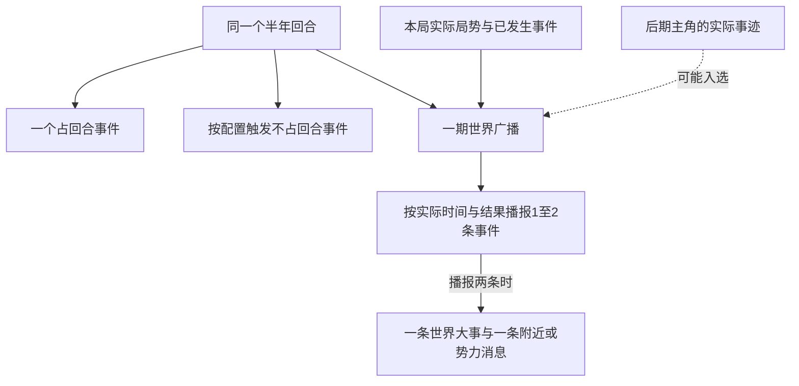

# 世界广播

天下有事，逐期播报。前期从广播中看时代变迁，后期主角开始发力，其事迹也可能为天下所闻。

记录日期：2026-10-18。每回合的播报数量、两条播报的内容分工、主角可进入广播及广播随实际局势变化已定；入选门槛、具体条目选取及播报时点待定。

## 基本规则

| 参数 | 规则 |
| --- | --- |
| 播报周期 | 每回合一期，即每半年一期 |
| 世界事件数量 | 每回合输出1—2条事件，反映本局实际发生的历史进程 |
| 两条播报的分工 | 一条为当前世界大事；另一条为主角所处地块附近或所属势力发生的事 |
| 播报依据 | 以本局实际局势、已经发生的事件及实际结果为准 |
| 主角参与 | 后期主角开始发力，其事迹也可能进入世界广播 |
| 主角入选依据 | 以本局实际发生的事迹为依据；具体门槛与选取办法待定 |

“后期开始发力”暂不换算为固定年龄、年份、威望或其他数值门槛。主角事迹按实际影响范围归入相应播报类别，具体入选门槛待定。

## 两条播报的分工

一回合播报两条时，内容按以下方式分配；表中类别不规定界面的展示先后。

| 类别 | 播报内容 |
| --- | --- |
| 世界大事 | 当前世界局势中的大事，依据本局实际发展选取 |
| 附近或势力消息 | 主角所处地块附近发生的事，或主角所属势力发生的事 |

第二条满足“地块附近”或“所属势力”任一关联即可：所属势力的事不必同时发生在主角附近，附近的事也不必属于主角所属势力。

主角的事迹达到相应范围时，也可进入这两类播报。附近消息与势力消息本身不要求主角亲自参与。

“地块附近”的具体范围、附近消息与势力消息之间如何选取，以及只播报一条时选哪一类，尚待确定。

## 随实际局势变化

原有历史作为参考。本局历史一旦改变，后续事件与广播都须依据变化后的局势判断；主角改变了历史，广播便跟着改变，不能继续照原来的历史播报。

| 本局情况 | 广播处理 |
| --- | --- |
| 历史事件在本局如实发生 | 按本局实际发生的时间与结果播报 |
| 事件的时间、参与者或结果发生变化 | 采用本局实际信息，调整对应播报 |
| 原定事件未发生，或其前提已经失效 | 不将其作为既成事实播报；该期从实际发生的其他事件中选取 |
| 某件事改变了后续局势 | 后续关联事件按新的局势重新判断，广播随实际发展更新 |

变化不限于直接提到主角的条目：主角造成的局势变化若影响其他人物、势力或后续事件，相应广播也要调整。未受影响的历史事件，仍可在本局实际发生后入选。

## 与回合事件的关系

世界广播是每回合的信息输出，不占用[时间与回合](./09-时间与回合.md)规定的唯一占回合事件名额，也不另行推进半年。

被播报事件的实际效果依原事件结算，广播引用其结果；同一件事被播报时不再次结算数值变化。因此，一个半年仍只有一个占回合事件，同时可以看到该期世界广播。

不占回合事件发生时，时间仍在同一半年，不额外生成新一期广播。广播在回合开始、结束或其他位置显示，尚待确定。

图示说明同一回合包含哪些内容，不规定执行先后；主角事迹按实际影响范围进入相应播报类别。

## 广播条目记录

条目暂按“所属回合、播报类别、关联事件、关联地块或势力、实际发生时间、实际结果、播报文本、是否涉及主角”记录，作为后续编排的字段草案。所有条目依本局实际发生时间归入对应期，保留实际事件结果与播报文字的对应关系。

## 待定细则

| 项目 | 待定内容 |
| --- | --- |
| 条目选取 | 每期取1条还是2条、只播一条时的类别、各类消息的筛选顺序与可播报事件不足时的处理 |
| 附近与势力 | 地块附近的范围、附近消息与所属势力消息之间的选取办法 |
| 主角入选 | 何种事迹可上广播、何时进入候选，以及归入相应类别的具体门槛 |
| 显示时点 | 每期在哪个回合环节播报、开局是否立即播报 |

事件的触发条件与结果字段见[事件参数与触发规则](./08-事件参数与触发规则.md)。
